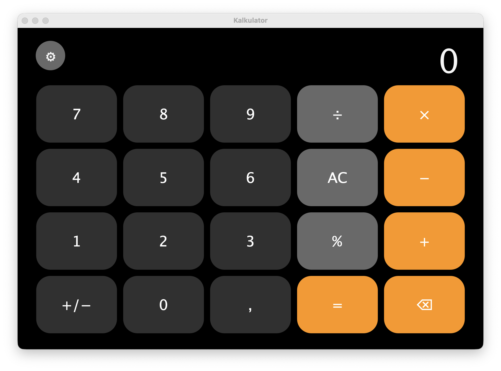

<div align="center">

# Java Swing Calculator

**Object Oriented Programming - using java swing**
  
<p>
 
  
  
  
  
</p> 
  
</div>

simple calculator built with **Java Swing**.
This project provides basic mathematical operations with a clean and simple UI. developed as a group project for the Object-Oriented Programming course.

## ✨ Features

|         Feature          |             Description            |
| ------------------------ | ---------------------------------- |
| ➕ Addition              | Add two numbers                    |
| ➖ Subtraction           | Subtract one number from another   |
| ✖️ Multiplication        | Multiply two numbers               |
| ➗ Division              | Divide one number by another       |
| 💯 Percentage            | Calculate percentage values        |
| 🔄 Positive / Negative   | Change number sign                 |
| ⌫ Backspace              | Delete the last digit              |
| 🧹 Clear                 | Reset calculator                   |
| ⌨️ Keyboard              | Basic keyboard input support       |
| 🎨 UI                    | Rounded calculator buttons         |

🖥️ Preview

<p align="center">
  
</p>

## Examples

### ➕ Addition

The addition calculation uses:

```text
FirstNumber + SecondNumber
```

Example:

```text
10 + 5 = 15
25 + 15 = 40
```

### ➖ Subtraction

The substraction calculation uses:

```text
FirstNumber - SecondNumber
```

Example:

```text
10 - 5 = 5
25 - 15 = 10
```

### ✖️ Multiplication

The multiplication calculation uses:

```text
FirstNumber × SecondNumber
```

Example:

```text
10 × 5 = 50
12 × 4 = 48
```

### ➗ Division

The division calculation uses:

```text
FirstNumber ÷ SecondNumber
```

Example:

```text
10 ÷ 5 = 2
100 ÷ 20 = 5
```


### 💯 Percentage

The percentage calculation uses:

```text
First Number × Percentage ÷ 100
```

Example:

```text
100 % 1 = 1
500 % 20 = 100
```

## 🛠️ Technologies

| Technology     | Usage                     |
| -------------- | ------------------------- |
| ☕ Java        | Programming language      |
| 🖼️ Java Swing  | Graphical User Interface  |
| ⚙️ AWT         | UI components and events  |

## Project Structure

```text
Calculator/
└── SwingCalculator.java
```

## Requirements

Before running the project, make sure you have:

- ☕ Java Development Kit (JDK)
- 💻 A Java version compatible with the source code
- 🖥️ A desktop environment that supports Java Swing


## 🚀 Run the Project

Compile the program:

```bash
javac SwingCalculator.java
```

Run:

```bash
java SwingCalculator
```

## ⌨️ Keyboard Support

The calculator also provides basic keyboard input support.

|        Key       |         Function        |
| ---------------- | ----------------------- |
| 0 - 9            | Enter numbers           |
| +                | Addition                |
| -                | Subtraction             |
| *                | Multiplication          |
| /                | Division                |
| % / Negative     | Percentage              |
| Enter            | Calculate               | 
| Backspace        | Delete last digit       |
| Esc              | Clear                   |


## 👥 Development Team

This project was developed as a group project for the Object-Oriented Programming course.

| 👨‍💻 Team Member           | 🎓 Student ID          |
| ------------------------ | ----------------------- |
| Siti Tara Maisura        |  250810701100012        |
| M. Dzaky Syraj           |  250810701100051        |
| Mirza Nur Akhyar         |  250810701100087        |
| T. Haikal Saputra        |  250810701100112        |

# 📦 Repository Maintainer

**</>Mirza Nur Akhyar</>**
GitHub: @yuenothingelse

The GitHub repository was initially created and managed by the repository
maintainer to organize and publish the project source code

# 🎯 Purpose

This project was developed as an Object-Oriented Programming (OOP) project using Java Swing.
The main purpose of this project is to apply fundamental object-oriented programming concepts while developing a functional desktop application with a graphical user interface.

Through this project, the development team practiced:

- 🧩 Object-oriented programming concepts
- 🏗️ Java class and object design
- 🎨 Graphical User Interface development
- ⚡ Event handling
- ⌨️ User input handling
- 🧮 Mathematical operation implementation

 <div align="center">

Made with Java ☕ and a little bit of mathematics 

</div>
